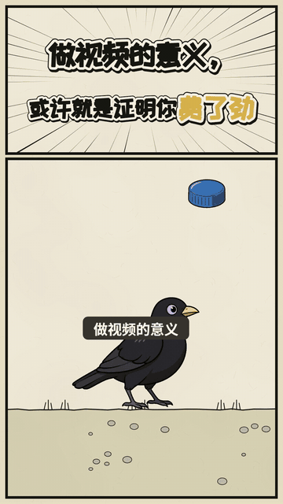
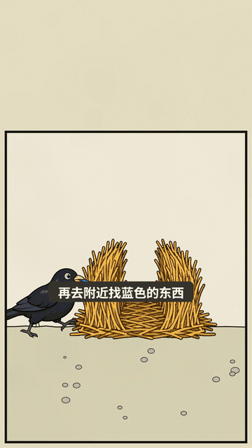
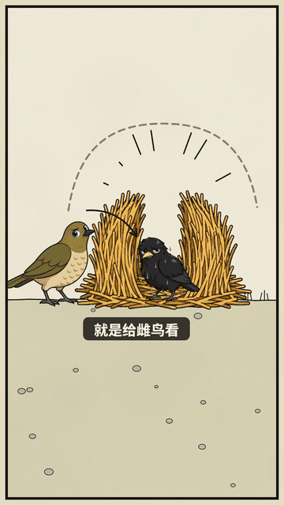

# comic-scroll-explainer 竖屏长漫画解说

一份口播稿进去，出来一条竖屏漫画片。整条片是一张往下翻的长漫画，镜头停一下，甩到下一格，再停。每句话都有个小角色当场演出来。

这是用这个 skill 做的 30 秒 demo，讲"做视频的意义，或许就是证明你费了劲"。上面是开头 7 秒：片名一上来就在，一个蓝瓶盖"啪"地落到园丁鸟脚边。然后镜头往下甩，甩出澳大利亚地图、园丁鸟的名字标签，再甩到它和雌鸟，头上冒出一座小房子的念头。

8–15 秒。草茎小房子搭好了，旁白每念一样蓝色的东西，上面就弹出一个小格：蓝花、蓝浆果、蓝瓶盖和吸管。然后鸟把它们一件一件叼回门口。

19.5–27.5 秒。房子只给雌鸟看。有的雄鸟去隔壁偷蓝瓶盖，顺手把人家房子拆了，拆的那一帧蹦出一个拟声字。接着"力气是装不出来的"，日历一页页翻，"你花了多少天"。

这条 demo 是一个没看过参考片的新 agent，只读这个 skill 做出来的。文案和配音是现成的，画面、分镜、动作、配乐都是它定的。

## 它和"口播配插图"有什么不一样

让 AI 做漫画解说，它通常一句话配一张图，图上慢推、淡入淡出。看几秒就腻。

这个 skill 只认一条：

> 漫画往下翻的顺序就是论证的顺序。论证走一步，镜头甩到下一格。

所以：

- 角色固定几个：主角（你/我）、一个蓝色的 AI、一只比喻动物。每句话是他们做的一个动作，不是一张静图。
- 抽象的道理换成人人认得的东西：讲"费劲"就是园丁鸟一根根搭草茎。
- 名字贴白底黑框标签，证据露出真排版的原件，动作做完那一帧出拟声字。
- 插画用 AI 生成（统一画风的透明素材），格子、字、镜头、特效全用代码画，每一帧可以单独渲出来检查。

## 怎么用

装进 `~/.claude/skills/`，然后对 Claude 说"做一条竖屏漫画解说""用漫画讲一个观点"。它会按这个顺序走，每一站都有产物：

文案 → 蓝图和逐句导演表 → 生图素材 → 搭工程 → 720p 预览自查 → 1080p 成片

要的东西：Node、Python、ffmpeg、一个能出图的生图接口。

## 里面有什么

| 文件 | 干什么 |
|---|---|
| `SKILL.md` | 入口：流程、每站产物 |
| `style-card.md` | 风格判断，每条带参考片的时间点 |
| `tokens.json` | 量出来的数：甩镜时长、格子几何、字幕、弹入、色板 |
| `references/` | 生图方法、配乐音效、样片前自查表 |
| `engine/` | SVG 渲染引擎，按时间逐帧渲染 |
| `scripts/` | 生主角姿势、抠图、字幕对齐、测量工具 |

## 现在的状态

- 30 秒 demo 做完了。完整的 130.8 秒片还没出。
- 风格学自两条参考片，所以先私有。
